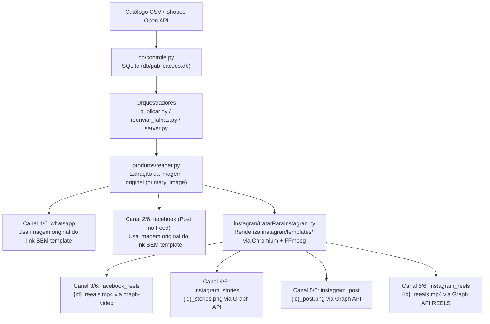

# Arquitetura e Fluxos do Sistema

Este documento descreve a arquitetura interna do **Afiliados Multi-Channel Hub**, os contratos entre seus módulos e o esquema relacional do banco SQLite.

---

## 1. Diagrama de Arquitetura e Fluxo de Publicação

---

## 2. Módulos do Projeto

| Módulo | Responsabilidade Principal |
| :--- | :--- |
| `server.py` | Servidor FastAPI que expõe a API REST para o painel Angular 22 e dispara publicações e reenvios em background (`BackgroundTasks`). |
| `publicar.py` | Orquestrador CLI para ingestão de arquivos CSV e publicação sequencial com intervalo configurável (`--delay`). |
| `reenviar_falhas.py` | Orquestrador cirúrgico que consulta `canais_status` e reprocessa exclusivamente os canais pendentes ou com falha de cada produto. |
| `db/controle.py` | Camada de persistência SQLite responsável pelo controle de duplicidade (`Item ID`), status individual dos 6 canais, histórico de auditoria, listas temáticas e cache de artes. |
| `instagran/tratarParaInstagran.py` | Motor gráfico que renderiza os arquivos HTML de `instagran/templates/` via Chrome/Chromium Headless (`1080x1080` e `1080x1920`) e codifica o vídeo `.mp4` de Reels via FFmpeg. |
| `facebook/client.py` | Cliente HTTP (stdlib) para a Meta Graph API (`v23.0`) voltado à Página do Facebook (`Linkolandiabr`): publicação de fotos por URL, upload multipart e envio de vídeos/Reels via `graph-video.facebook.com`. |
| `instagran/client.py` | Cliente HTTP (stdlib) para a Instagram Graph API (`@linkolandiabr`): publicação no Feed, Stories e Reels (`media_type=REELS` via `video_url` público efêmero). |
| `whatsapp/client.py` | Cliente HTTP (stdlib) para envio de mensagens de texto e imagens (URL ou Base64 Data URI) ao grupo `Linkolandiabr` via Z-API. |
| `shopee/client.py` | Cliente GraphQL autenticado (SHA-256) para a Shopee Affiliate Open API: busca de ofertas, geração de shortlinks rastreados por canal (`sub_ids`) e reconciliação de conversões. |
| `produtos/reader.py` | Leitor de arquivos CSV de ofertas da Shopee e extrator de imagens de alta resolução a partir das páginas de produto. |

---

## 3. Esquema do Banco de Dados (`db/publicacoes.db`)

O banco SQLite é inicializado e migrado automaticamente por `inicializar_banco()` em `db/controle.py`:

1. **`produtos_publicados`:**
   - Armazena os metadados mestre de cada produto (`item_id` como chave primária, `item_name`, `price`, `sales`, `shop_name`, `commission_rate`, `commission`, `product_link`, `offer_link`, `image_url`, `codigo_artes`, `pasta_artes`, `lista_nome`, `criado_em`, `atualizado_em`).
2. **`canais_status`:**
   - Controla o estado atual de entrega de cada produto nos 6 canais obrigatórios (`item_id`, `canal`, `status` em `PENDENTE | SUCESSO | FALHA`, `id_externo`, `mensagem_erro`, `tentativas`, `link_rastreado`, `atualizado_em`).
   - Chave primária composta: `(item_id, canal)`.
3. **`historico_logs`:**
   - Trilha de auditoria imutável de cada tentativa de envio (`id`, `item_id`, `canal`, `status`, `id_externo`, `caminho_imagem`, `link_rastreado`, `mensagem_erro`, `registrado_em`).
4. **`listas_produtos`:**
   - Agrupamento temático de ofertas para filtragem no painel administrativo (`nome`, `criado_em`).
5. **`conversoes_shopee`:**
   - Armazena relatórios de comissões e pedidos retornados pela Shopee Affiliate Open API (`conversion_id`, `order_id`, `item_id`, `sub_id`, `commission`, `order_status`, `purchase_time`).
